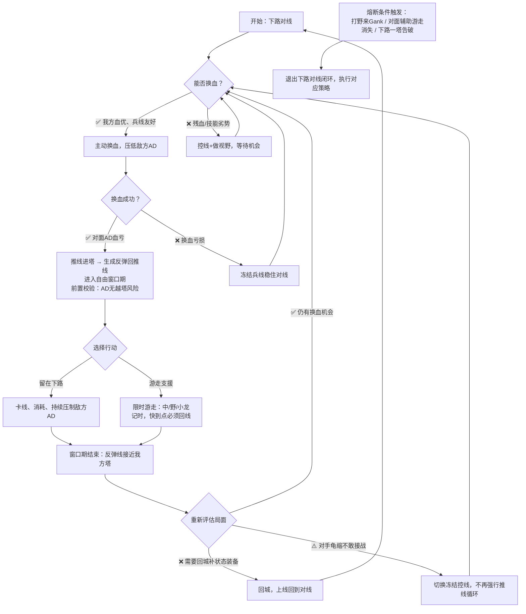

---
tags:
  - 辅助
  - 对线期
  - 决策流程
  - 复盘
aliases:
  - 下路对线闭环
  - 对线期流程图
  - 换血决策树
---

# 下路对线期决策闭环

> 把辅助对线期拆成一个可持续运转的循环：**能不能打 → 打完赚没赚 → 赚了怎么用窗口 → 窗口结束怎么重开**。

## 流程图

## 四个判断节点的判据

### B：能否换血

| 条件 | 结论 |
| --- | --- |
| 我方血量领先 + 兵线在我方半场或均势 | 打 |
| 我方残血 / 关键技能 CD / 对面辅助有反手 | 不打，控线等 |
| 对面 AD 站位靠前且无辅助保护 | 打 |

硬辅还要加一条：**兵线必须在己方塔前**才考虑开，否则被远程辅助白耗。

### E：换血是否成功

标准有两条，只满足第一条不算成功：

1. 对面 AD 血量掉得比我方多
2. **我方 AD 有能力把这波兵推过去**（否则造不出反弹线）

只赚血量、推不动线，属于"半成功"：这次窗口只能用于回城，不能用于游走。

### F → H：窗口期选什么

| 条件 | 选择 |
| --- | --- |
| AD 状态好、能单吃线 | 游走 |
| AD 状态差 / 对面打野位置未知 | 留线 |
| 我方 AD 是弱势期英雄 | 留线 |
| 中路有击杀机会 / 小龙即将刷新 | 游走 |

**游走的前置校验不能省**：确认 AD 无越塔风险、对面打野不在下半区。

### K → L：窗口结束的标志

反弹线推回、**兵线快要离开己方塔下**时，窗口就结束了。这是强制回线节点，不是建议。

## 熔断条件

这套闭环有三个必须立刻跳出循环的输入，不要试图在循环内消化：

| 熔断条件 | 跳出后执行 |
| --- | --- |
| 打野来 Gank | 判断是反蹲还是撤退，见[[团战技能留给最高价值时刻]]的反手逻辑 |
| 对面辅助游走消失 | [[反制对面辅助游走]]——立刻激进惩罚对面 AD |
| 下路一塔告破 | [[一塔解放后的换线转资源]]——换线中 → 小龙 → 上塔 |

## 常见错误映射

这个流程图实际上是把 7 个高频错误串成了因果链：

| 环节 | 对应错误 |
| --- | --- |
| A → B | 错误 1：拉野太久，开局就落后推线权 |
| B → C | 错误 2：等到 2 级才开，错过信息差 |
| E → F | 错误 3：不懂反弹线，赚了血也不会用 |
| F → J | 错误 4：不敢游走，窗口期白费 |
| 熔断① | 错误 5：对面辅助游走不反制 |
| 熔断③ | 错误 6：一塔后不知干嘛 |
| 全局 | 错误 7：技能无脑甩，换血账算错 |

## 关联

- [[反弹线 回推线]]
- [[集火敌方AD]]
- [[反弹线窗口期游走]]
- [[游走必须按时回下路]]
- [[按辅助类型分工]]
- [[辅助 MOC]]
